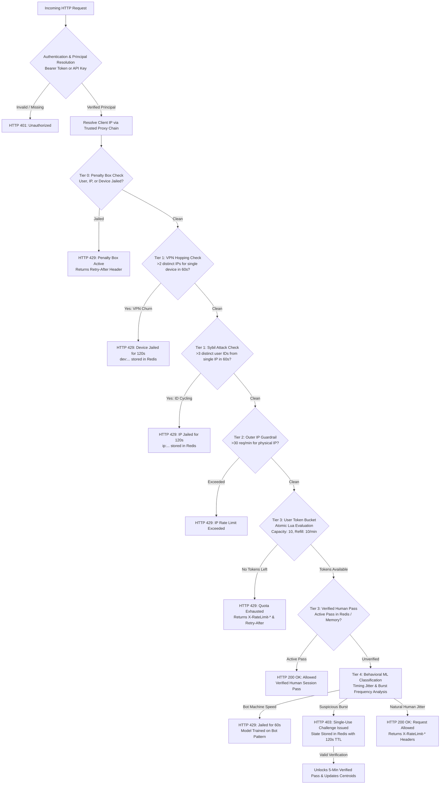

# Distributed Rate Limiter & Multi-Tier Abuse Defense System

A production-ready distributed rate limiting and defense-in-depth abuse mitigation system built with **FastAPI**, **Redis**, the **Token Bucket algorithm**, and an **Online Self-Learning Gaussian Anomaly Detection Engine**.

---

## 🌟 Security Architecture & Execution Flow

Incoming requests pass through a strictly prioritized, multi-tier evaluation pipeline before accessing protected resources:



---

## 🛡️ Multi-Tier Defenses & Threat Model

| Defense Layer | Mechanism | Protection Provided | Limitations & Threat Boundaries |
| :--- | :--- | :--- | :--- |
| **Authentication & Principal Resolution** | HMAC-SHA256 token verification with constant-time comparison, expiry (3600s), and clock skew limits | Binds user quotas to verified cryptographic identities. Rejects forged, unsigned (`usr_*`, `token_*`), expired, or low-entropy credentials. | Requires secure distribution of `AUTH_SECRET_KEY` (minimum 32 bytes / 256 bits of random material). |
| **Token Bucket Quota** | Atomic Redis Lua script using Redis server clock (`TIME`) | Strict ceiling on request throughput per authenticated `user_id` (10 req/min). | Application-layer only. Large-scale volumetric L3/L4 DDoS attacks require upstream scrubbing (Cloudflare, AWS Shield). |
| **Physical IP Guardrail** | Outer Token Bucket tracking IP addresses (30 req/min) | Prevents runaway consumption from a single physical connection or network. | Shared public NATs (universities, corporate offices) share quota. Configurable via subnets. |
| **Trusted Proxy Resolution** | Reverse proxy chain traversal (RFC 7239 compliant) | Rejects spoofed `X-Forwarded-For` headers from untrusted direct peers. | Requires operator to correctly configure `TRUSTED_PROXIES` CIDRs in production. |
| **Sybil Attack Defense** | Atomic sliding window in Redis tracking `user_id` velocity per IP | Jails IP for 120s if $>3$ distinct user accounts are rotated within a 60-second window. | High-density NAT environments should tune `max_allowed_ids` or rely on user authentication tokens. |
| **VPN Hopping Defense** | Sliding window tracking IP velocity per Device Fingerprint | Jails Device Fingerprint for 120s if a single client rotates across $>2$ IPs in 60 seconds. | Header-based device fingerprinting is heuristic; sophisticated attackers can spoof browser attributes. |
| **Self-Learning Gaussian Anomaly Detector** | Bivariate Gaussian mixture tracking request interval jitter ($\sigma$) and burst sizes | Automatically flags zero-jitter robotic traffic and challenges suspicious micro-bursts. | Cold-start sensitivity is bounded by pre-seeded baseline centroids; model adapts online via verified feedback. |
| **Challenge-Based Verification** | Single-use challenges with cryptographic IDs, Redis TTL (120s), and attempt caps (3 max) | Allows false-positive human traffic to prove legitimacy and calibrate Gaussian parameters online. Binds verification strictly to authenticated principal. | Arithmetic challenges serve as automated script friction and model calibration signals, NOT bulletproof proof-of-human CAPTCHAs. |
| **Penalty Box Escalation** | Multi-target penalty lookup (`user_id`, `client_ip`, `device_id`) | Rapidly isolates abusive actors with geometric strike escalation (1x, 2x, 3x duration). | Stored with finite TTLs in Redis to prevent permanent lockout of reclaimed dynamic IPs. |

---

## 🔑 Authentication & Identity Security

Production deployments strictly require cryptographic authentication (`REQUIRE_AUTH=true` by default):

1. **HMAC-SHA256 Bearer Tokens**:
   - Format: `<user_id>:<timestamp>:<signature>`
   - Generated with `create_signed_token(user_id)`.
   - Verified via `verify_signed_token(token)` using `hmac.compare_digest` (timing-attack resistant).
2. **Token Lifetime & Skew Enforcement**:
   - Default lifetime: 3600 seconds (1 hour). Expired tokens return `401 Unauthorized`.
   - Future timestamps exceeding 60 seconds clock skew are rejected.
3. **No Unsigned Tokens**:
   - Unsigned shorthand patterns like `token_<user_id>` or `usr_<user_id>` are strictly rejected.
4. **Anti-Spoofing & Unified Endpoints**:
   - Both `/limited-resource` and `/verify-challenge` share the exact same `get_authenticated_principal` dependency.
   - When an authenticated token is present, any client-supplied `user-id` header or body payload is ignored. The rate-limiting and challenge-verification identity is derived exclusively from the verified principal.
5. **Strict Production Environment Isolation**:
   - In production (`ENVIRONMENT=production` or default), client-provided `user-id` headers are **ALWAYS prohibited**, regardless of other flags.
   - `ALLOW_UNAUTHENTICATED_DEV_HEADERS=true` is strictly rejected at startup in production.
   - Development-only client headers require explicit non-production configuration (`ENVIRONMENT=development` and `REQUIRE_AUTH=false` and `ALLOW_UNAUTHENTICATED_DEV_HEADERS=true`).
6. **Entropy Validation (Length is Not Entropy)**:
   - `AUTH_SECRET_KEY` must have a minimum length of 32 characters (256 bits).
   - In production, keys must contain securely generated random material: minimum 10 unique symbols and Shannon entropy $\ge 3.0$ bits/symbol. Trivial keys (such as `"x" * 32` or `"01" * 16`) and known documentation placeholders are rejected.
   - Generate a secure key with:
     ```bash
     python -c "import secrets; print(secrets.token_hex(32))"
     ```
7. **Strict Boolean Configuration Parsing**:
   - Configuration options like `REQUIRE_AUTH` and `ALLOW_UNAUTHENTICATED_DEV_HEADERS` strictly accept recognized boolean tokens (`true`, `false`, `1`, `0`, `yes`, `no`). Typos (e.g. `REQUIRE_AUTH=treu`) immediately fail startup rather than silently defaulting to insecure states.
8. **Startup-Time Lifespan Validation**:
   - Validation occurs eagerly during FastAPI application initialization (`lifespan`), halting process launch immediately on configuration errors or contradictory settings before traffic can be received. Secrets are never logged.

---

## ⚙️ Configurable Failure Modes

When Redis becomes unreachable, the rate limiter adheres to an explicitly configured failure mode policy:

1. **`fail_closed` (Default & Recommended)**:
   - Rejects unthrottled requests with `503 Service Unavailable`.
   - Applied consistently across both user and physical IP rate limiters.
   - Recommended for high-security, paid API, or compute-intensive endpoints where uncontrolled traffic could crash backend dependencies.
2. **`fail_open`**:
   - Allows requests to proceed unthrottled during an outage.
   - Suitable for mission-critical read endpoints prioritizing 100% availability over strict rate enforcement.
3. **`local_fallback`**:
   - Degrades to a thread-safe, memory-bounded (LRU/TTL) in-memory Token Bucket on each application worker.
   - **Operational Note**: Local fallback does NOT provide globally consistent distributed enforcement. Multiple instances maintain independent quotas. When Redis recovers, local consumption is not reconciled with Redis state.

---

## 📊 Standard RFC Rate-Limit Headers

All responses set standard IETF / RFC rate-limiting headers:

| Header | Description | Example |
| :--- | :--- | :--- |
| `X-RateLimit-Limit` | Maximum token burst capacity for the user | `10` |
| `X-RateLimit-Remaining` | Remaining tokens available in the current window | `7` |
| `X-RateLimit-Reset` | Seconds until the bucket refills to full capacity | `18` |
| `Retry-After` | Seconds client must wait before retrying (present on all `429 Too Many Requests` responses) | `60` |

---

## 📈 Prometheus Metrics & Observability

The application exposes real-time telemetry at `GET /metrics` in Prometheus text format (version 0.0.4):

- `ratelimit_requests_total{status="allowed|rate_limited|jailed|challenge_required"}`
- `ratelimit_redis_connected` (gauge: 1 = healthy, 0 = disconnected)
- `ratelimit_jailed_total` (counter of penalty box jailing events)
- `ratelimit_challenges_issued_total`
- `ratelimit_challenges_verified_total`
- `ratelimit_challenges_exhausted_total`
- `ratelimit_sybil_attacks_detected_total`
- `ratelimit_vpn_hopping_detected_total`
- `ratelimit_model_version` (gauge tracking online learning iterations)

---

## 🔒 Administrative Endpoint Security

The diagnostic endpoint `GET /model-stats` exposes active model centroids, evaluation counters, and jailed users.
- In production, set `ADMIN_API_KEY` in your environment.
- When configured, requests require the `x-admin-key: <ADMIN_API_KEY>` header (returns `401 Unauthorized` if invalid or missing).
- If `ADMIN_API_KEY` is empty (default dev mode), open access is allowed for convenient inspection.

---

## 🚀 Quick Start & Deployment

### Local Development Setup

1. **Clone repository & set up virtual environment**:
   ```bash
   git clone https://github.com/sharvi16/distributed-rate-limiter.git
   cd distributed-rate-limiter
   python -m venv .venv
   source .venv/bin/activate  # On Windows: .\.venv\Scripts\Activate.ps1
   pip install -r requirements.txt
   ```

2. **Configure environment**:
   ```bash
   cp .env.example .env
   # Generate your secret key:
   python -c "import secrets; print(secrets.token_hex(32))"
   ```

3. **Start local Redis**:
   ```bash
   redis-server
   ```

4. **Run FastAPI with Uvicorn**:
   ```bash
   uvicorn main:app --host 127.0.0.1 --port 8000 --reload
   ```

---

### Docker & Docker Compose Deployment

Run the complete multi-worker FastAPI application cluster and Redis service:

```bash
docker compose up --build
```

The stack launches:
- **`redis`**: Redis 7 Alpine with Append-Only File (AOF) persistence and health checks.
- **`api`**: Multi-worker FastAPI running as non-privileged `appuser` with automated health checks.

---

## 🧪 Comprehensive Automated Test Suite

The test suite contains **94 exhaustive unit, integration, distributed, and security tests** executed via Pytest:

```bash
pytest tests/ -v
```

### Test Categories:
- **`tests/security/test_priority1_audit.py`** (43 tests): Redis failure modes at API level, challenge session binding, cryptographic token verification (HMAC-SHA256, expiry, future skew, unsigned token rejection), secret key entropy (Shannon entropy & diversity vs length), known placeholder blocklist, strict boolean configuration parsing, startup configuration validation through FastAPI lifespan, production vs development environment isolation, prohibition of unauthenticated headers in production, and identity anti-spoofing.
- **`tests/unit/test_token_bucket.py`** (11 tests): Capacity, refill math, oversized requests, atomic concurrency, failure modes (`fail_closed`, `fail_open`, `local_fallback`), and RFC headers.
- **`tests/unit/test_challenge.py`** (8 tests): Cryptographic ID generation, single-use enforcement, attempt exhaustion, user-session binding, and answer leak prevention.
- **`tests/integration/test_model_sync.py`** (4 tests): Gaussian centroid persistence across restarts, cross-instance synchronization, and atomic EMA Lua updates.
- **`tests/integration/test_identity_tracking.py`** (5 tests): Atomic sliding window Lua scripts, VPN hopping detection, Sybil attack velocity, and strike-based penalty escalation.
- **`tests/integration/test_api_endpoints.py`** (5 tests): Rate limit headers, 429 retry-after behavior, admin key protection, and Prometheus `/metrics` scraping.
- **`tests/security/test_header_spoofing.py`** (10 tests): Trusted proxy chain traversal, untrusted `X-Forwarded-For` rejection, CIDR subnet matching, and device fingerprint entropy.
- **`tests/distributed/test_multiple_instances.py`** (4 tests): Multi-worker shared quota enforcement, cluster-wide penalty propagation, and distributed model synchronization.
- **`tests/distributed/test_redis_failure.py`** (4 tests): Network partition simulation and graceful fallback behavior.

---

## ⚡ Performance Benchmarking

A reproducible load testing tool is included to benchmark throughput and latency percentiles under high concurrency:

```bash
python benchmarks/load_test.py
```

Outputs duration, throughput (req/s), P50, P90, P99, Max latencies, and HTTP status code distribution.
