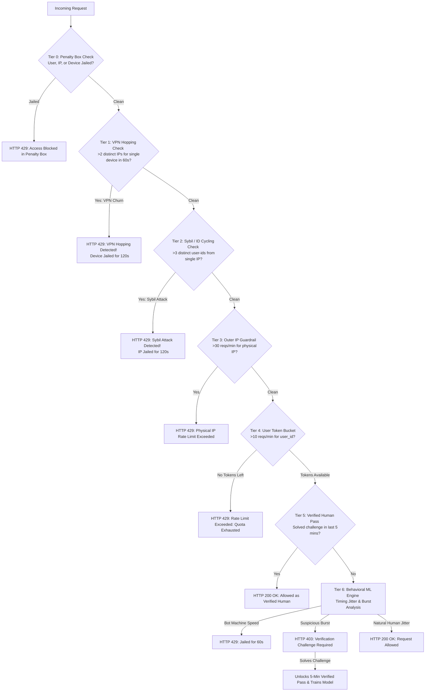

# Distributed Rate Limiter & Multi-Tier Abuse Defense System

An enterprise-grade, distributed rate limiting and anti-abuse architecture built with **FastAPI**, **Redis**, the **Token Bucket algorithm**, and an **Online Self-Learning Anomaly Detection Engine**.

---

## 🌟 Security Architecture & Defenses



---

## 🛡️ Defenses Against Modern Attacks

| Attack Vector | How It Works | How Our System Neutralizes It |
| :--- | :--- | :--- |
| **Volumetric DDoS** | Sending hundreds of requests per second. | **Token Bucket (10 reqs/min)** hard ceiling stops all traffic. |
| **Robotic Scraping** | Bots sending rapid requests with machine-like timing ($<0.05$s gaps). | **Behavioral ML Timing Jitter ($\sigma$) Engine** detects zero-jitter metronomic timing and jails the bot on request #3. |
| **Sybil Attack (User-ID Cycling)** | Script cycles through `user_1`, `user_2`, `user_3` to get 10 fresh tokens each time. | **Identity Velocity Tracker** detects $>3$ distinct IDs from one IP in 60s and **jails the physical IP**. |
| **VPN / Proxy IP Rotation** | Attacker switches VPNs to rotate IP addresses. | **Device Fingerprinting & VPN Hopping Detector** detects a single device rotating across multiple IPs and **jails the Device Fingerprint (`dev_...`) for 120s**. Switching IPs will not unblock them! |
| **CAPTCHA Hell for Humans** | Legitimate fast humans getting constantly challenged on every click. | **Verified Human Session Pass**: Solved challenge grants a 5-minute verified pass to browse smoothly under their 10-req quota. |

---

## 🚀 Quick Start & Testing

### 1. Start the API Server
```powershell
.\.venv\Scripts\uvicorn.exe main:app --reload
```
Server runs at `http://127.0.0.1:8000`.

### 2. Run Verification & Interactive Demo

#### A. Master Exhaustive Test Suite (20 Automated Security Checks)
```powershell
.\.venv\Scripts\python.exe master_audit.py
```
Audits all 8 dimensions: Infrastructure, Real Human browsing, Bot detection, Human Challenge solving & 5-min Verified Pass, Hard 10-req quota, Sybil Attack defense, VPN Hopping device lockout, and Fault-Tolerance Edge Cases.

#### B. Interactive Terminal Demo
```powershell
.\.venv\Scripts\python.exe demo.py
```
Simulates real humans, burst challenges, and robotic spammers in real-time with visual terminal outputs.
